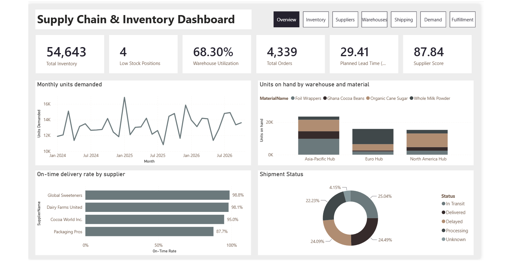
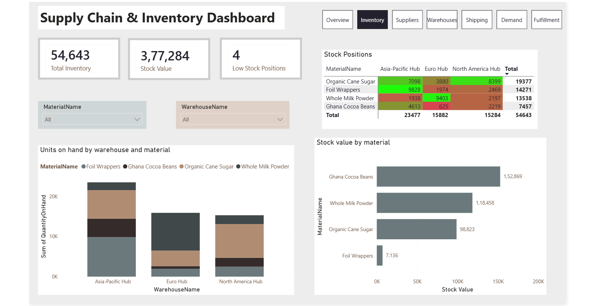
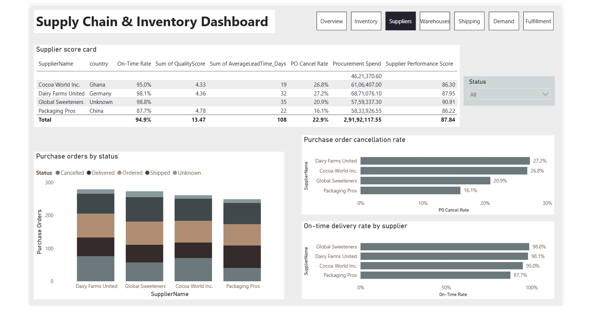
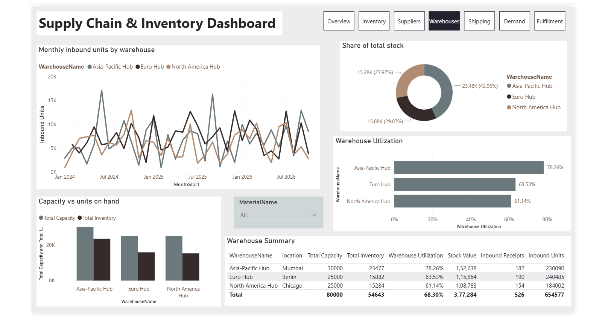
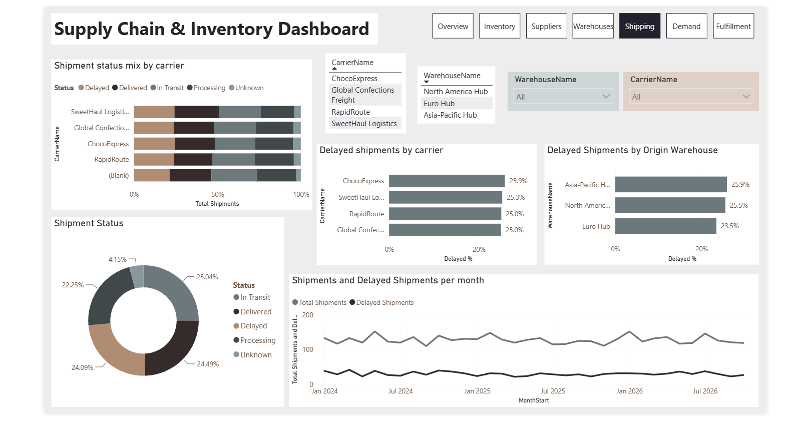
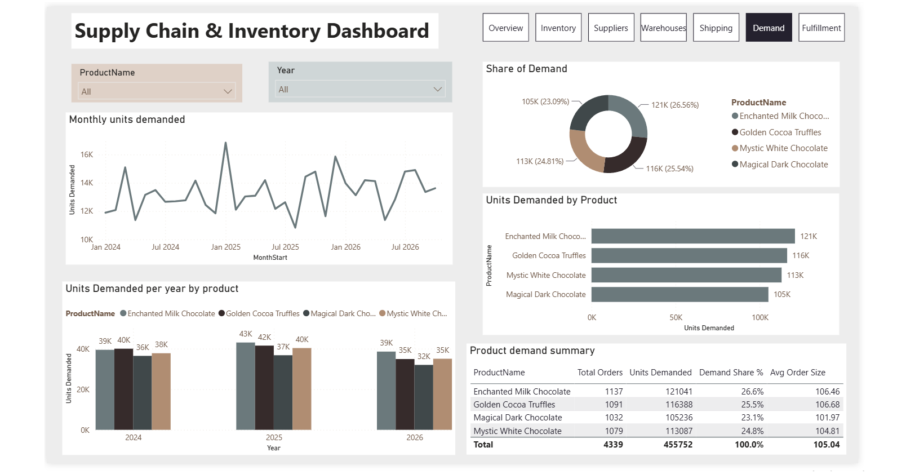
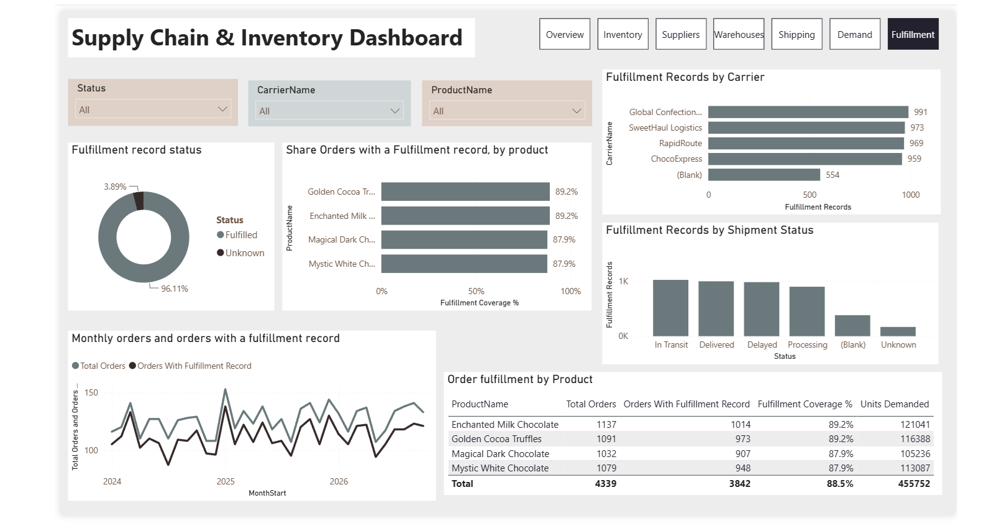

# Supply Chain & Inventory Analytics

End-to-end analysis of procurement, inventory, shipping and demand data using **MySQL, Python (Pandas) and Power BI**, with an automatically generated PDF report.

**Author:** Rakhi Mete

## Business problem

A manufacturing company has stock imbalances between warehouses, unreliable suppliers and no clear view of shipping delays. This project answers: where is stock thin or concentrated, which suppliers are reliable, how is demand behaving, and what should the company do about it?

## Dashboard preview



| | |
|---|---|
|  |  |
|  |  |
|  |  |

## Key findings

- **Spend is concentrated:** Ghana Cocoa Beans account for 57.7% of procurement spend.
- **High-value stock is thin in one place:** cocoa beans are 40.5% of stock value but only 13.6% of units, and the Euro Hub holds just 625 units.
- **Stock is uneven:** the Asia-Pacific Hub holds 43% of all units; North America holds 28%.
- **Suppliers trade off speed, reliability and quality:** Packaging Pros has the lowest on-time rate (87.7%) but the best quality score (4.78) and lowest PO cancellation rate (16.1%). Overall, 22.9% of purchase orders are cancelled.
- **Delays are network-wide:** about 25% of shipments are marked Delayed for every carrier and warehouse, so no single carrier is the problem.
- **Demand is stable:** about 12,800 to 13,700 units a month with modest growth.

## What I did

| Stage | Details |
|---|---|
| Data cleaning (Pandas) | 12 related tables loaded; stray spaces, text dates, duplicate rows and repeated IDs removed; missing values handled by rule (drop, fill or leave blank); every change logged |
| SQL (MySQL) | 10 required queries plus CTE and window-function queries (RANK, LAG, running totals) |
| EDA and charts | 10 analysis tasks and 10 charts (histograms, box plots, scatter, heatmap, pair plot) |
| Automated report | One Python script generates the PDF report and a business insights document from the cleaned data |
| Power BI | 7-page dashboard (Overview plus Inventory, Suppliers, Warehouses, Shipping, Demand, Fulfillment) with 6 KPI cards and DAX measures |

## Data

The dataset is **synthetic**, generated with the Excelx Supply Chain and Logistics Data Generator (12 related tables, "slightly messy" setting). Raw files are in `data/raw/` and were never edited.

## Assumptions and limitations

- The data is generated, so patterns are weaker than in real operational data.
- There are no actual delivery dates, so "delay" uses the shipment Status field and "delivery time" uses planned lead time.
- Shipment dates are not linked to order dates, so order-to-ship time cannot be measured.
- All stock movements are inbound, so inventory turnover cannot be calculated.
- Warehouse capacities (30,000 / 25,000 / 25,000 units) are **assumed**, so utilization is illustrative.
- Joins from lines or shipments to their parent orders leave out rows whose parent was removed during cleaning, so linked spend totals are lower than totals over all order lines.
- Only 4 suppliers, 4 materials and 3 warehouses exist, so rankings are indicative.

## Project structure

```
supply-chain-analytics/
├── data/
│   ├── raw/          original generated files (never edited)
│   └── cleaned/      cleaned CSVs
├── notebooks/
│   ├── 01_load_and_explore.ipynb   load, inspect and clean
│   ├── 02_pandas_eda.ipynb         EDA and business insights
│   ├── 03_visualization.ipynb      10 charts
│   └── 04_load_to_mysql.ipynb      load cleaned tables into MySQL
├── sql/              MySQL schema and queries
├── reports/          automated PDF report, insights document, generator script
├── dashboards/       Power BI file and PDF export
└── images/           charts and dashboard screenshots
```

## How to run

1. Run the notebooks in order (01 to 03).
2. Create the MySQL database `supply_chain`, run the schema script in `sql/`, then run notebook 04 to load the data.
3. Generate the report: `python reports/generate_report.py`
4. Open `dashboards/supply_chain_dashboard.pbix` in Power BI Desktop.

Python packages: pandas, numpy, matplotlib, seaborn, sqlalchemy, pymysql, reportlab, pillow.

## Deliverables

- [PDF report](reports/Supply_Chain_Analysis_Report.pdf)
- [Business insights document](reports/business_insights.md)
- [Dashboard PDF export](dashboards/supply_chain_dashboard.pdf)
